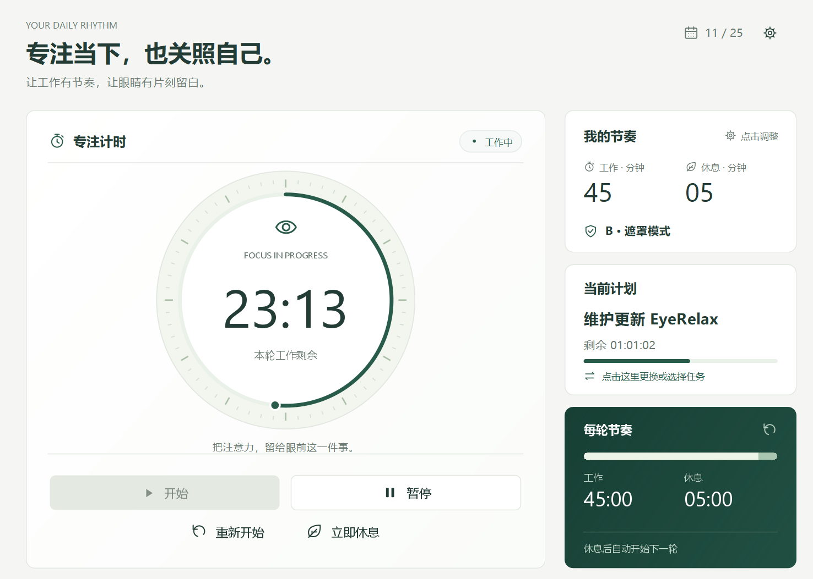
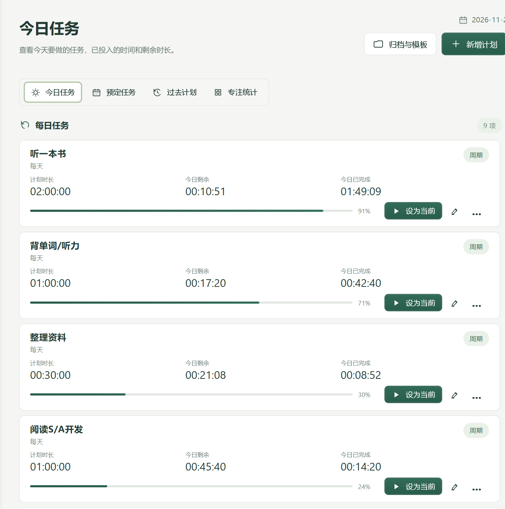
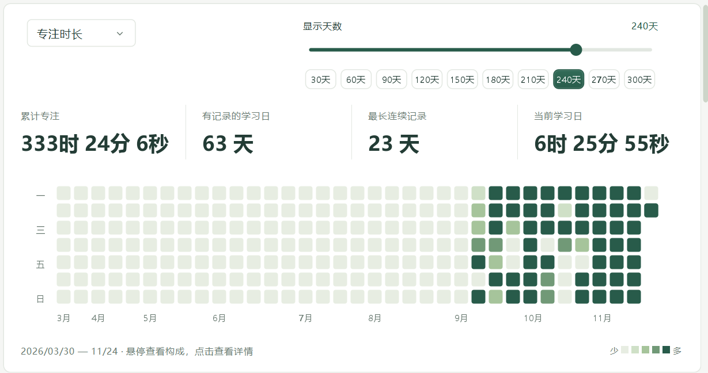
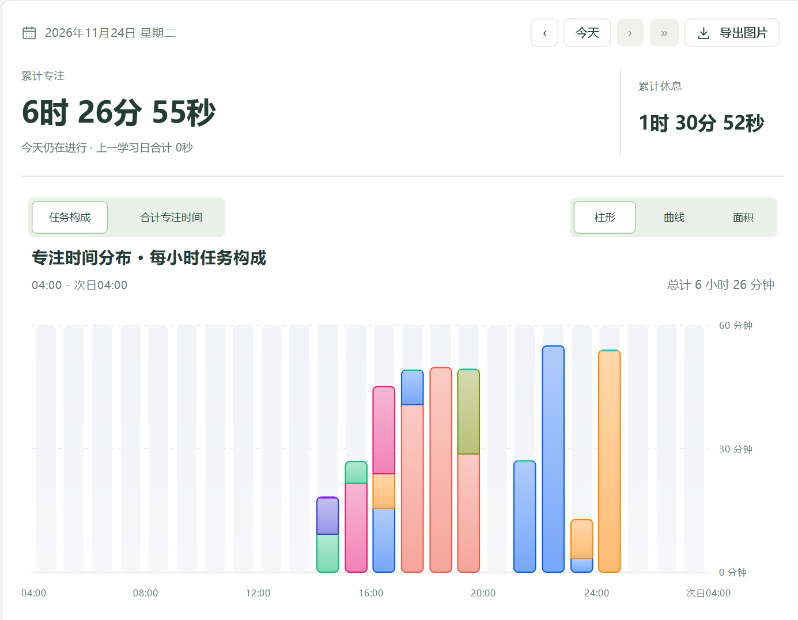
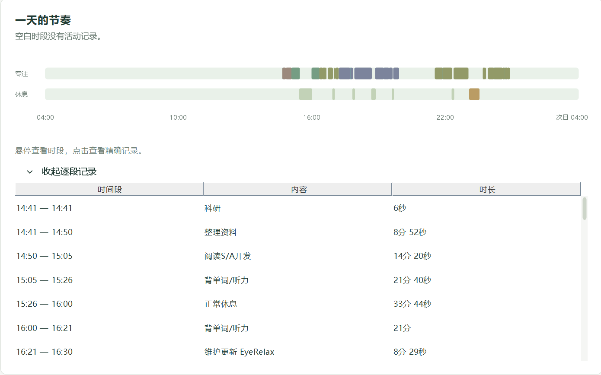
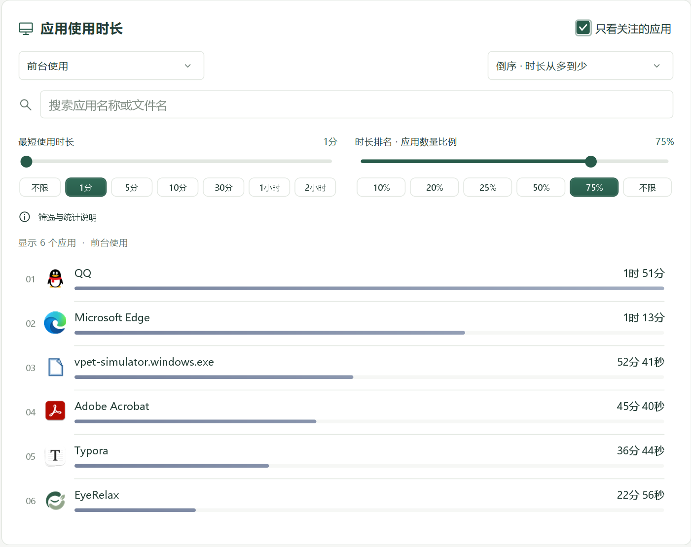

**EyeRelax —— 一款以强制休息、时间规划、使用限制和数据复盘为核心的个人时间管理工具。**

>  EyeRelax 最初的诞生，仅仅是为了让一个整天坐在电脑前的人，能够每隔一段时间站起来走走。

我们并不缺乏投入学习与工作的热情，而是缺乏对时间与节奏的合理管理。

**一、强制休息**

你是否经历过整天坐于电脑前，不知不觉忘记时间，直到身心俱疲？可能你并不是没有意识到这样的危害，但当你沉浸在任务中时，你只是缺少一个主动停下来的契机。

EyeRelax 为你提供一种可靠的保证。它允许你选择合适的工作 / 休息时间分配，并在休息时间内强制锁定电脑，让你的身体和大脑在高强度工作时间后得以喘息。

**二、合理规划**

你是否经历过满满的规划任务，最后却被一个项目占满所有时间？

《时间盒》一书提出了“有效专注”的概念：提前规划需要完成的任务，为每项任务分配明确的时间，将它们像物品一样装进不同的时间盒中，然后一次只做一件事。

这个方法听起来很简单，但真正困难的是坚持每天提前规划，并且始终专注于当前任务。

而 EyeRelax 允许你提前建立未来的学习 / 工作规划并分配对应的时间，在工作时间片段内选择相应的计划并统计时间，最后在当前计划达到预设时长后发出提示，从而帮助你完成既定的计划。

**三、结果统计**

你又是否在忙碌一周后，回首却发现好像时间白白流逝，而你根本不记得曾做过什么？

EyeRelax 建立了全面的统计分析并可视化展示：

- 辅助记录当天的计划完成情况，每小时学习时间统计，实际工作 / 休息时间轴
- 近一周工作时间等信息统计、对比，30 - 240天可滑动的时间热力图
- 选定某一长期任务分析时间段内的完成情况
- 追踪当天实际应用使用情况，提供近一周 / 一月对比

相信你随时想回顾时，可以结合这些图表可以让你快速回忆起自己的工作，也可以帮助你认识到哪几天你真的特别刻苦，而哪几天你 “偷懒” 了。

**四、其它功能**

EyeRelax 还有很多其它使用的小功能：例如可以设置指定应用的使用时长限制；可以设置一个喝水的追踪任务，每四十五分钟提醒一次，期间同样会锁屏强制你完成等等。欢迎你实际下载安装体验！！ [点击下载](https://github.com/lyqk2024/EyeRelax/releases/latest)

**五、总结展望**

EyeRelax 由个人开发和维护，目前仅支持 Windows 版本，而现有功能大多源于开发者自身的实际需求，也许难以覆盖广大用户的需求。

因此对于以下情况欢迎积极提交 issue 或反馈至开发者邮箱：

1. 对于使用过程中出现的 bug；

2. 如有希望添加或优化的功能；
3. 愿意参与 EyeRelax 的开发和维护。

手机版本及 Linux 会视情况开发公布！！欢迎持续追踪项目进展！！！！

**六、软件实际使用截图**

